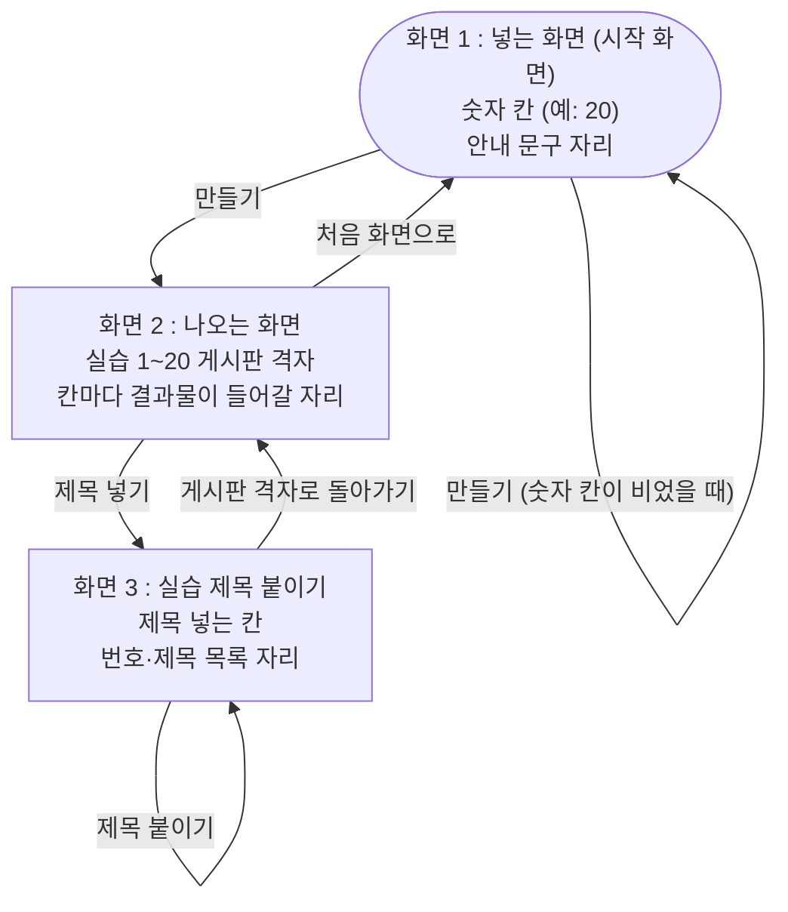

# PRD — 클래스플로우

- 상태 : 완성
- 한 줄 정의 : 실습 개수를 넣으면 실습별 결과물 게시판이 한 화면에 격자로 한 번에 만들어지는 도구

## 1. 문제

### 배경

- 실습이 스무 개쯤 되는 과정을 온라인 강사가 혼자 진행한다. (user.md)
- 지금은 실습마다 노션 갤러리 페이지를 하나씩 복사해 만들고, 채팅에 링크를 붙여 준다. (user.md)
- 실습마다 결과물 받을 페이지를 따로 만들어야 하고, 누가 안 올렸는지 이름을 하나씩 대조해야 한다. (user.md)
- 손이 가는 때는 실습 슬라이드를 넘길 때마다, 그리고 수업이 끝나고 결과물을 확인할 때다. (user.md)

### 목표

- 실습 개수 하나만 넣으면 실습별 결과물 게시판이 번호 순으로 한 번에 만들어지게 한다. (ipo.md)
- 만들어진 게시판이 한 화면에 격자로 다 보여서, 실습 게시판을 찾아 헤매지 않게 한다. (ipo.md)
- 측정 지표 : 실습 20개짜리 과정의 결과물 게시판 만들기에 드는 시간이 1시간에서 10분으로 줄어든다.

## 2. 사용자

### 페르소나

- 누구인가 : 실습이 스무 개쯤 되는 과정을 혼자 진행하는 온라인 강사 (본인) (user.md)
- 언제 쓰는가 : 실습 슬라이드를 넘길 때마다, 그리고 수업이 끝나고 결과물을 확인할 때 (user.md)
- 왜 쓰는가 : 실습마다 결과물 받을 페이지를 따로 만들고, 누가 안 올렸는지 이름을 하나씩 대조해야 해서 (user.md)
- 지금 방식 : 노션 갤러리 페이지를 실습마다 복사해 만들고, 채팅에 링크를 붙여 준다 (user.md)

### 사용자 스토리

- 혼자 과정을 진행하는 강사로서, 실습 개수를 한 번만 넣어 실습별 결과물 게시판을 한 번에 만들고 싶다. 실습마다 페이지를 따로 복사해 만드는 일을 없애기 위해서다.
- 혼자 과정을 진행하는 강사로서, 만들어진 게시판을 한 화면에 격자로 보고 싶다. 실습 스무 개를 한눈에 훑기 위해서다.
- 혼자 과정을 진행하는 강사로서, 격자에서 실습 칸 하나를 눌러 그 게시판을 크게 보고 싶다. 그 실습의 결과물만 따로 확인하기 위해서다.
- 혼자 과정을 진행하는 강사로서, 격자에서 칸 안의 번호 버튼을 눌러 그 게시판 링크를 복사하고 싶다. 슬라이드를 넘길 때 채팅에 바로 붙이기 위해서다.
- 혼자 과정을 진행하는 강사로서, 개수를 비워 두고 만들기를 눌렀을 때 무엇이 빠졌는지 바로 알고 싶다. 빈 게시판 묶음이 잘못 만들어지는 것을 막기 위해서다.
- 혼자 과정을 진행하는 강사로서, 실습 제목을 한 줄에 하나씩 붙여 넣어 게시판마다 제목이 붙게 하고 싶다. 번호만으로는 어느 실습인지 알기 어렵기 때문이다.
- 혼자 과정을 진행하는 강사로서, 화면 사이를 버튼으로 오가고 싶다. 개수를 다시 넣거나 격자로 돌아오기 위해서다.

## 3. 범위

### 넣을 기능

1. 실습 개수를 넣으면 실습마다 결과물 게시판이 한 번에 만들어진다 (핵심) — scope.md 1, ipo.md
2. 게시판이 격자로 한 화면에 깔리고, 칸을 누르면 그 게시판이 커진다 — ipo.md, wireframe.png 화면 2
3. 칸 안에 번호가 적힌 버튼을 따로 두고, 그 버튼을 누르면 그 게시판 링크가 복사된다 — scope.md 5
4. 개수를 비워 두고 만들기를 누르면 안내 문구가 뜨고 게시판은 만들지 않는다 — ipo.md, wireframe.png 화면 1
5. 실습 제목 목록을 붙여 넣으면 게시판마다 그 실습 제목이 붙는다 — scope.md 2, wireframe.png 화면 3
6. 화면 사이를 버튼으로 오간다 ([제목 넣기], [처음 화면으로], [게시판 격자로 돌아가기]) — flow.md, wireframe.png

### 기능 요구사항

1. 숫자 칸에 실습 개수를 넣고 [만들기]를 누르면, 넣은 개수만큼 실습별 결과물 게시판이 번호 순으로 만들어지고 화면 2로 넘어간다.
2. 화면 2가 열리면 게시판 칸이 넣은 개수만큼(20을 넣으면 칸 20개) 가로세로로 깔려 한 화면에 다 보이고, 칸마다 실습 번호가 적혀 있으며, 칸을 누르면 그 게시판이 커진다.
3. 칸 안의 번호 버튼을 누르면 그 실습 게시판 링크가 복사된다. 칸의 나머지 자리를 누르면 게시판이 커지는 것과 나뉜다.
4. 숫자 칸을 비운 채 [만들기]를 누르면, 입력창에 빨간 테두리가 남고 그 아래에 "실습 개수를 넣어 주세요"가 한 줄 뜨며, 게시판은 만들어지지 않는다.
5. 제목 넣는 칸에 실습 제목을 한 줄에 하나씩 넣고 [제목 붙이기]를 누르면, 번호와 제목이 짝지어진 목록이 화면 3 아래에 나온다.
6. 화면 2에서 [제목 넣기]를 누르면 화면 3으로 가고, [처음 화면으로]를 누르면 화면 1로 돌아가며, 화면 3에서 [게시판 격자로 돌아가기]를 누르면 화면 2로 돌아간다.

### 비목표

이번 버전에서는 아래를 하지 않는다. 한 번에 기능을 많이 넣지 않으려고 다음 버전 후보로 미룬다.

- 만든 게시판을 노션 갤러리 페이지로 내보내기 (scope.md 4)
- 수강생 명단과 제출 여부 확인 — 명단 넣기, 안 올린 사람 목록, 가로세로 표, 이름 맞추기, 명단 복사 (scope.md 8~16)
- 게시판 모양 통일(3), 전체 링크 목록(6), 안내 문장 자동 생성(7), 차례로 넘겨 보기(17)

## 4. 화면

### 사용자 흐름

- 화면 1 : 넣는 화면 (시작 화면) — 숫자 칸(예: 20), 안내 문구가 뜨는 자리, [만들기] 버튼이 있다. (wireframe.png 1a, flow.md)
- 화면 2 : 나오는 화면 — "실습 1~20 게시판" 제목 아래 번호가 적힌 게시판 격자, 칸마다 결과물이 들어갈 자리와 링크를 복사하는 번호 버튼, [제목 넣기]와 [처음 화면으로] 버튼이 있다. (wireframe.png 1b, flow.md)
- 화면 3 : 실습 제목 붙이기 — 한 줄에 하나씩 제목 넣는 칸, [제목 붙이기]와 [게시판 격자로 돌아가기] 버튼, 번호·제목을 짝지어 보여 주는 목록 자리가 있다. (wireframe.png 1c, flow.md)
- 화면 3으로 들어가는 경로 : 화면 2에 [제목 넣기] 버튼을 하나 더 둔다. (flow.md 의 남은 문제를 이렇게 정했다. wireframe.png 에는 아직 이 버튼이 그려져 있지 않다.)

## 5. 완성 기준

### 수용 기준

- 숫자 칸에 20을 넣고 [만들기]를 누르면, 게시판 칸 20개가 가로세로로 깔려 한 화면에 다 보인다. (ipo.md)
- 게시판 칸마다 실습 번호가 적혀 있고, 번호 순으로 놓여 있다. (ipo.md)
- 게시판 칸을 누르면 그 게시판이 커진다. (ipo.md)
- 화면 2에서 칸 안의 번호 버튼을 누르면, 그 게시판 링크가 복사되어 채팅에 붙여 넣으면 그대로 들어간다. (scope.md 5)
- 숫자 칸을 비운 채 [만들기]를 누르면, 입력창에 빨간 테두리가 남고 그 아래에 "실습 개수를 넣어 주세요"가 한 줄 뜨며, 게시판은 만들어지지 않는다. (ipo.md)
- 화면 2에서 [제목 넣기]를 누르면, 화면 3이 열리고 제목 넣는 칸과 번호·제목 목록 자리가 보인다.
- 화면 2에서 [처음 화면으로]를 누르면 화면 1로 돌아간다. (flow.md, wireframe.png)
- 화면 3에서 제목을 한 줄에 하나씩 넣고 [제목 붙이기]를 누르면, 번호와 제목이 짝지어진 목록이 나온다. (wireframe.png 1c)
- 화면 3에서 [게시판 격자로 돌아가기]를 누르면 화면 2로 돌아간다. (flow.md, wireframe.png)
